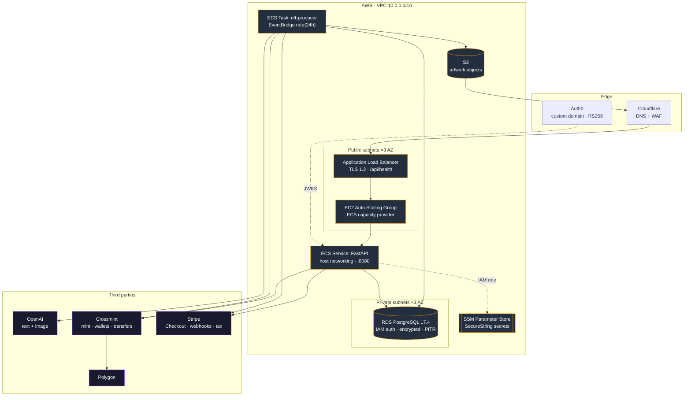
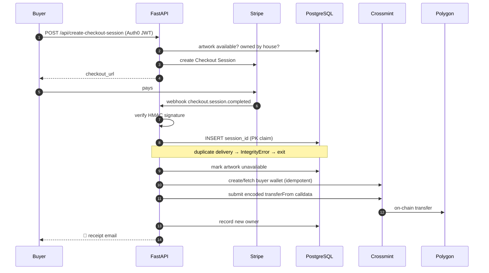
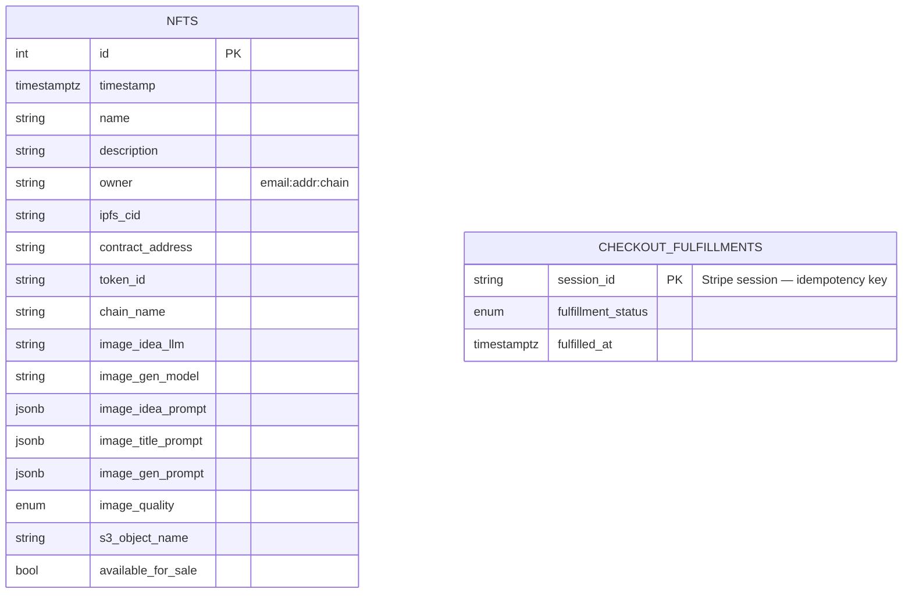

# NFTbyAI — Backend & Infrastructure

**An autonomous, self-stocking NFT storefront.** A scheduled AI pipeline invents original artwork, mints it on-chain, and lists it for sale — with no human in the loop. When a customer pays, a second pipeline provisions them a wallet and transfers the token to it, exactly once, even under retries and partial failures.

<p>
  
  
  
  
  
  
  
  
</p>

---

## Table of contents

- [What it actually does](#what-it-actually-does)
- [Architecture](#architecture)
- [The hard part: exactly-once fulfillment](#the-hard-part-exactly-once-fulfillment)
- [Engineering highlights](#engineering-highlights)
- [Repository layout](#repository-layout)
- [Infrastructure](#infrastructure)
- [Data model](#data-model)
- [Running it locally](#running-it-locally)
- [Deployment](#deployment)

---

## What it actually does

The system runs two independent loops that never talk to each other directly — they meet in the database.

### 🎨 The supply loop — runs itself, daily

An EventBridge schedule fires an ECS task once every 24 hours. With no operator involvement it:

1. Asks GPT for an original, deliberately *non-AI-sounding* art concept (temperature 1.4, with a negative-prompt exclusion list tuned from observed model bias).
2. Asks a second completion for a punchy 1–4 word title.
3. Renders the concept through OpenAI's image model at 1024×1536.
4. Stores the raw bytes in S3 under a UUID key and issues a presigned URL.
5. Mints it as an NFT on Polygon via Crossmint, polling the mint status until IPFS pins and a `tokenId` is assigned (24 attempts, 30s apart).
6. Creates the matching Stripe `Product` and `Price` — keyed to the same S3 UUID, which is what later lets a webhook resolve a payment back to an artwork.
7. Writes a full provenance row to Postgres: every prompt, model name, image size, quality, contract address, token ID, and IPFS CID.

The storefront restocks itself. Cost per unit is bounded and known; the schedule is one line of Terraform.

### 💳 The demand loop — payment to on-chain delivery

A customer authenticates through Auth0, hits `POST /api/create-checkout-session`, and is handed a Stripe Checkout URL. On payment, Stripe calls a signature-verified webhook, and the backend:

1. Claims the fulfillment (see [below](#the-hard-part-exactly-once-fulfillment)).
2. Resolves the Stripe product back to the artwork row and marks it unavailable.
3. Creates — or idempotently re-fetches — an EVM smart wallet for the buyer via Crossmint, linked to their email.
4. **Hand-encodes an ERC-721 `transferFrom` call**: derives the 4-byte selector from the function signature, ABI-encodes `(address,address,uint256)`, concatenates, and submits the raw calldata as a Crossmint transaction.
5. Records the new owner and emails the buyer a receipt with wallet sign-in instructions.

If anything in that chain throws, the exception is re-raised (so Stripe retries) *and* a full traceback is emailed to an operator address — the failure is never silent.

---

## Architecture



The two ECS workloads share one cluster and one database but have **separate IAM task roles, separate security groups, and separate log groups** — the producer can write artwork and read its own secrets; the API can read the parameters it needs and nothing else.

---

## The hard part: exactly-once fulfillment

Stripe webhooks are *at-least-once*. They retry on timeout, on 5xx, and on network blips. Fulfillment here means **minting money-equivalent value onto a blockchain** — doing it twice means transferring an asset you no longer own, or transferring two.

The solution is a database primary key used as a distributed lock:

```python
async with session_maker() as db_session:
    db_session.add(CheckoutFulfillment(session_id=session_id))
    try:
        await db_session.commit()
    except IntegrityError:
        # Another delivery of this same event already claimed it. Stop.
        return None
```

The Stripe `session_id` *is* the primary key of `checkout_fulfillments`. The first webhook delivery inserts and proceeds; every concurrent or subsequent delivery hits a uniqueness violation and exits cleanly. No advisory locks, no Redis, no race window — the guarantee is enforced by Postgres itself, in a single round trip.

Layered on top of that:

- **Signature verification first.** The raw request body is verified against the Stripe signing secret before anything is parsed, in a worker thread so the event loop isn't blocked by the HMAC.
- **Idempotency keys downstream.** Both the wallet-creation and NFT-transfer calls to Crossmint carry `x-idempotency-key: {session_id}`, so even a retry that somehow got past the claim can't double-execute at the provider.
- **An availability invariant.** If fulfillment ever reaches an artwork already marked sold, it raises loudly rather than transferring — the code treats that as a critical, alert-worthy inconsistency.
- **The webhook is a separate ASGI app.** It's mounted as a sub-application specifically so the CORS middleware does *not* apply to it — browser origin rules have no business governing a server-to-server callback.



---

## Engineering highlights

### 🛡️ Defense in depth

- Traffic ingress is a chain, not a flat network: Cloudflare IP ranges → ALB security group → ECS instance security group → RDS security group. The database lives in private subnets and accepts connections *only* from the two workload security groups.
- The S3 bucket policy for the static site is scoped to Cloudflare's published CIDR ranges, pulled live via the Cloudflare provider rather than hardcoded.
- TLS 1.3 (`ELBSecurityPolicy-TLS13-1-2-2021-06`) terminates at the ALB.
- The API container rebuilds its CA trust store at build time with the AWS RDS global certificate bundle, so `sslmode=require` verifies a real chain rather than trusting blindly.
- Rate limiting via `slowapi` on the ASGI middleware stack.
- Database privileges are themselves Terraform-managed: a dedicated `app_user` role with `rds_iam` and *default privileges* granted per-table and per-sequence, provisioned through the PostgreSQL provider over an SSH tunnel from a bastion host.

### 🧱 Infrastructure as Code, genuinely multi-environment

Terraform modules are environment-agnostic; Terragrunt supplies the differences. Staging and production run the *same* module source with different inputs — different AWS accounts, different Auth0 tenants, different Crossmint collections, and different chains (`polygon-amoy` for staging, `polygon` for production).

Dependency wiring is declarative — the `app` stack consumes the `platform` stack's outputs through Terragrunt `dependency` blocks, so subnet IDs and RDS endpoints are never copy-pasted between layers. Remote state lives in per-account S3 buckets with native lockfile-based concurrency control.

Notably, module variables deliberately have **no defaults** for anything environment-specific. A missing production value fails `terraform plan` loudly instead of silently deploying staging configuration to production.

### ⚡ Async where it counts, threads where it must

The request path is async throughout — `asyncpg`, `httpx`, `async_sessionmaker`. Where a synchronous dependency sits on a hot path, it's pushed to a worker thread with `asyncio.to_thread` rather than stalling the loop: Stripe's HMAC verification on every inbound webhook, and `smtplib` on every outbound email.

Outbound calls to Crossmint — the ones that can actually move an asset — go through a `tenacity` wrapper with random exponential backoff, capped attempts, and an explicit 10-second timeout, so a hung third party can't wedge a worker indefinitely.

### 📋 Provenance as a first-class feature

Every generated artwork stores the exact prompts (as JSONB), the exact model identifiers, image size, and quality that produced it. Image generation isn't deterministic, so this doesn't buy reproducibility — it buys **auditability**. Months later you can still answer "which model made this, and what was it asked?" for any token on the chain.

---

## Repository layout

```
.
├── fastapi-backend/           # Customer-facing API (ECS service)
│   ├── app/
│   │   ├── app.py             # Routes, CORS, rate limiting
│   │   ├── stripe_webhook.py  # Signature verification + fulfillment saga
│   │   ├── db_connection.py   # Async engine w/ RDS IAM token refresh
│   │   ├── verify_token.py    # Auth0 JWKS verification
│   │   ├── settings.py        # Pydantic settings + SSM secret resolution
│   │   ├── models.py          # SQLAlchemy 2.0 typed ORM
│   │   └── email_service.py   # Multi-mailbox transactional email
│   └── alembic/               # Schema migrations
│
├── produce_nft/               # Autonomous generation pipeline (scheduled ECS task)
│   └── produce_nft.py         # idea → title → image → S3 → mint → Stripe → DB
│
├── lambdas/                   # Operational one-shots
│   └── setup_rds_users/       # Bootstraps the rds_iam application role
│
├── infrastructure/
│   ├── modules/
│   │   ├── platform/          # VPC, RDS, S3, ECR, Cloudflare
│   │   ├── app/               # ECS cluster, ALB, ASG, scheduler, IAM
│   │   ├── db_configuration/  # Postgres roles & grants
│   │   └── bastion_host/      # Tunnel for private DB access
│   ├── staging/               # Terragrunt: staging inputs
│   └── production/            # Terragrunt: production inputs
│
└── .github/workflows/         # OIDC-authenticated build & deploy
```

The frontend lives in a separate repository.

---

## Infrastructure

| Component | Configuration |
|---|---|
| **Compute** | ECS on EC2 with an Auto Scaling Group capacity provider; `host` network mode; Fargate capacity providers declared for burst |
| **Database** | RDS PostgreSQL 17.4, `db.t4g.micro`, gp3, encrypted at rest, 7-day backup retention, IAM auth enabled |
| **Networking** | VPC across 3 AZs, 3 public + 3 private subnets, ALB on 443 |
| **Scheduling** | EventBridge Scheduler → `RunTask`, `rate(24 hours)` |
| **Registry** | Two ECR repositories, images pushed by OIDC-authenticated Actions |
| **State** | S3 remote backend, per-environment bucket, lockfile concurrency |
| **Observability** | CloudWatch Logs per workload; structured JSON logging in the producer; failure alerts by email with tracebacks |

---

## Data model



`nfts.s3_object_name` is the join key that ties an artwork to its S3 object, its Stripe product (`prod_{uuid}`), and its Stripe price (`price_{uuid}`) — one identifier, four systems.

---

## Running it locally

**Prerequisites:** Python 3.12, PostgreSQL, and AWS credentials with read access to the relevant SSM parameters.

```bash
cd fastapi-backend
python -m venv .venv && source .venv/bin/activate
pip install -r requirements.txt
```

Create `fastapi-backend/.env`. Settings are validated by Pydantic at import — a missing required key fails fast with a clear error:

```dotenv
environment=local
REGION=us-east-1

# Auth0
auth0_custom_domain=https://your-tenant.auth0.com
auth0_default_domain=https://your-tenant.auth0.com
auth0_issuer=https://your-tenant.auth0.com/
auth0_api_audience=https://your-api/
auth0_algorithms=RS256

# Database — set DB_PASS locally to bypass RDS IAM auth
DB_USER=postgres
DB_PASS=postgres
DB_HOST=localhost
DB_PORT=5432
DB_NAME=nfts_dev
REQUIRE_SSL=false

# Secrets: provide inline locally, or point the *_SSM_PATH vars at Parameter Store
STRIPE_SECRET_KEY=sk_test_...
STRIPE_WEBHOOK_SIGNING_SECRET=whsec_...
CROSSMINT_SECRET_KEY=...

ALLOW_ORIGINS_URLS=["http://localhost:3000"]
FRONTEND_URL=http://localhost:3000
SUCCESSFULL_PURCHASE_URL=http://localhost:3000/confirmation
FAILED_PURCHASE_URL=http://localhost:3000
NFT_IMAGE_STORAGE_URL=https://your-bucket.s3.us-east-1.amazonaws.com
DEFAULT_NFT_OWNER=email:you@example.com:polygon
NFTBYAI_WALLET_ADDRESS=0x...
SMTP_HOST=smtp.example.com
SMTP_PORT=465
SMTP_USER=you@example.com
REPORT_TO_EMAIL=you@example.com
```

Apply migrations and start the server:

```bash
alembic upgrade head
uvicorn app.app:app --reload --port 8000
```

Interactive API docs at `http://localhost:8000/docs`.

To exercise the webhook path, forward real events with the Stripe CLI:

```bash
stripe listen --forward-to localhost:8000/webhooks/stripe/
```

---

## Deployment

All deployment runs through GitHub Actions with OIDC — no static AWS credentials anywhere.

| Workflow | Purpose |
|---|---|
| `push_backend_webserver_to_{staging,production}` | Build and push the API image to ECR |
| `push_generate_nft_to_{staging,production}` | Build and push the producer image to ECR |
| `deploy-platform` | Apply the VPC / RDS / S3 / ECR layer |
| `deploy-app` | Apply the ECS / ALB / scheduler layer |
| `create_rds_users` | Bootstrap the `rds_iam` application role |

Applying infrastructure directly:

```bash
cd infrastructure/production/platform && terragrunt apply
cd ../app                             && terragrunt apply
```

Terragrunt resolves `platform → app` ordering from the declared dependencies.

---

<p align="center">
  <sub>Built with FastAPI, Terraform, and a genuine dislike of manual deployment steps.</sub>
</p>
